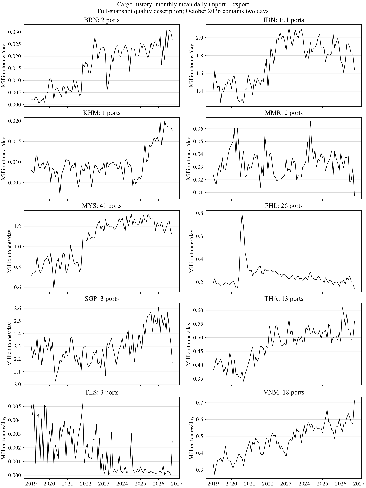
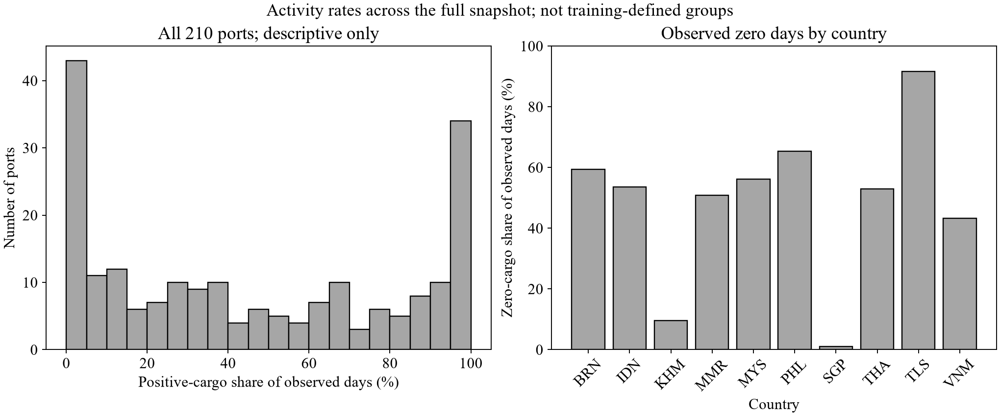
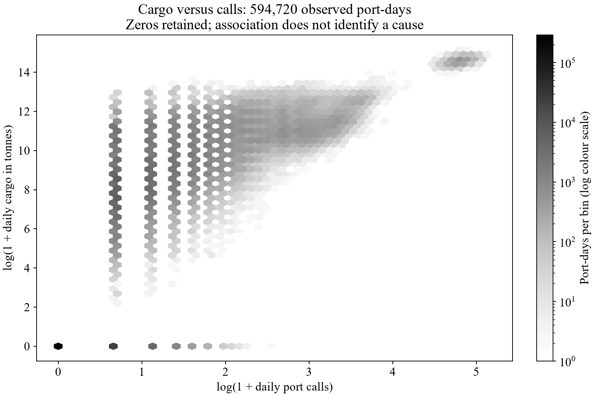

# Data and Exploratory Analysis

## Data provenance and scope

The verified snapshot contains 594,720 source rows for 210 port/terminal IDs in 10 coastal Southeast Asian countries. Source observations span 2019-01-01 to 2026-10-02 (2832 calendar days). Local download date(s): 2026-10-18, independently of the group's reported 12 October copy. Matching preliminary counts does not establish byte identity. The SHA-256 bundle is `fb4eee5b71de5692334abc45fadbee522fc32572e30ded15f2e6daeade137070`; its definition and individual file hashes are in `docs/portwatch_snapshot_manifest.json`.

The canonical panel has 594,720 rows with unique `(port_id,date)` keys, sorted by port and date. The calendar check found 0 absent source records. Missing cargo measurements: 0. Negative numeric source measurements: 0. Invalid numeric source values: 0. No original row was deleted and no measurement was imputed, clipped or replaced. If another snapshot contains invalid keys, duplicate keys or invalid required measurements, preparation stops for investigation.

There are 322,534 observed zero-cargo days out of 594,720 known cargo days (54.2329%). The measured proportion rounds to the preliminary 54.2%. The positive-cargo count is 272,186. Missing cargo is outside this zero-rate denominator. On 30,228 zero-cargo days, port calls are positive (9.37% of observed zeros). A reported zero is retained as an observed source value; it is not proof of no vessel activity or of a confirmed reporting gap.

The core task forecasts total estimated cargo during the seven calendar days after each origin, with daily cargo defined as published import plus export. The acquisition covers Brunei Darussalam, Cambodia, Indonesia, Malaysia, Myanmar, the Philippines, Singapore, Thailand, Timor-Leste and Viet Nam. Lao PDR belongs to national trade/transit analysis in the broader proposal and is outside the repository's core port forecast. The older five-country repackaged data are not mixed into this snapshot.

## Preparation and measurement

Preparation verifies every raw file hash, validates date and port keys, checks numeric values, and reindexes each port over a common daily calendar. Published midnight UTC observation labels become ISO calendar dates. Unknown measurements remain missing; cargo is unknown if either import or export is unknown. The full source schema has 29 fields. The shared panel contains exactly the seven agreed columns, and source names and cleaning rules are retained in the dictionary. Port names are metadata rather than identifiers. Aggregate shipment estimates are used directly to avoid double-counting category subtotals.

## Zero days and activity heterogeneity

Country coverage and observed zero frequencies are shown below.

| country_iso3 | ports | calendar_rows | zero_days | zero_pct | zero_days_with_calls |
| --- | --- | --- | --- | --- | --- |
| BRN | 2 | 5664 | 3367 | 59.45 | 154 |
| IDN | 101 | 286032 | 153267 | 53.58 | 11526 |
| KHM | 1 | 2832 | 272 | 9.60 | 17 |
| MMR | 2 | 5664 | 2878 | 50.81 | 44 |
| MYS | 41 | 116112 | 65234 | 56.18 | 1694 |
| PHL | 26 | 73632 | 48086 | 65.31 | 11366 |
| SGP | 3 | 8496 | 94 | 1.11 | 32 |
| THA | 13 | 36816 | 19516 | 53.01 | 1651 |
| TLS | 3 | 8496 | 7779 | 91.56 | 30 |
| VNM | 18 | 50976 | 22041 | 43.24 | 3714 |

Observed zero-day shares range from 1.11% in SGP to 91.56% in TLS. The pooled zero rate masks substantial country heterogeneity; later evaluation should retain country and port breakdowns.

There are 1,173 zero runs lasting at least 28 days, across 97 ports; 622 of these runs include positive port calls. Such patterns warrant source review but do not by themselves establish missing records, port closure or data errors. All observed zeros are retained. A future imputation or eligibility sensitivity must be justified and evaluated on validation without changing the scoring rows.

The source entity coverage is broader than conventional port names alone: 44 IDs carry source names containing Offshore Oil Terminal. Of the 8 entire-snapshot zero-cargo entities, 7 are source-labelled offshore oil terminals; the audit identifies any remaining source IDs/names explicitly. This metadata pattern motivates source review and careful interpretation, not an automatic exclusion or a claim that all zero estimates are reporting gaps.

Observed zeros must remain in both the history and seven-calendar-day target. Deleting zero days would compress time, change the horizon and condition the sample on positive activity. Unknown cargo is a different case: it prevents construction of a complete feature/target window under the shared protocol and must not be replaced with zero by default.

The country histories show monthly means of daily estimated cargo; they describe all available observations, including the two-day October 2026 endpoint. They are not forecasts or comparisons of full monthly totals.

The full-snapshot activity distribution motivates analysis of sparse activity. It is descriptive and is not reused as training-defined eligibility or as an activity group assignment.

Cargo and calls are different measures. The presence of calls on 30,228 zero-cargo days demonstrates why zero estimated volume should not automatically be interpreted as no vessel activity. This association does not identify the cause of the estimated volume.

## Training-only eligibility and validation handoff

The recorded time boundaries are training 2019-01-01 through 2024-12-31, validation 2025-01-01 through 2025-12-31, and test 2026-01-01 through 2026-10-02. Han reported Dinh and Hieu's agreement on 20 October 2026. The supplied Word proposal is not the source of these exact cutoffs.

The current candidate retains 137 of 210 source IDs using only 2192 training calendar days. It requires cargo coverage >= 100% and a positive-cargo share >= 20%. Every excluded ID and reason is in `results/port_selection_audit.csv`. Observed zeros remain in all retained ports' histories and targets; no date is removed because it has zero cargo. The fixed low/medium/high bands have lower-inclusive cuts at [0.3333333333333333, 0.6666666666666666]; group counts are {'high': 67, 'low': 23, 'medium': 47}. The bands are descriptive design choices applied to training shares, not thresholds fitted on future data.

| country_iso3 | candidate_ports | retained_ports | excluded_ports |
| --- | --- | --- | --- |
| BRN | 2 | 1 | 1 |
| IDN | 101 | 71 | 30 |
| KHM | 1 | 1 | 0 |
| MMR | 2 | 1 | 1 |
| MYS | 41 | 24 | 17 |
| PHL | 26 | 14 | 12 |
| SGP | 3 | 3 | 0 |
| THA | 13 | 7 | 6 |
| TLS | 3 | 1 | 2 |
| VNM | 18 | 14 | 4 |

Country retention describes this candidate only. The rule remains unfrozen pending the joint Task 2 validation review. `results/eligibility_validation.md`, when generated by the documented validation command, records the independent sensitivity check for that review.

The implementation records both the calendar-day denominator and the observed-cargo denominator, exclusion reasons and retention by country. No full-sample count, including an earlier claim of 138 ports, is treated as a training-only finding. The exact dates are recorded from the user's confirmation of team agreement, not inferred from auxiliary trade-data coverage.

Task 2 owns the production learning table and baseline comparisons. A separate Task 1 sensitivity check can exercise the shared protocol for joint review without replacing Task 2's deliverables. Candidate rules must share valid evaluation origins and complete feature/target windows, with labels entirely inside their assigned periods. Selection, grouping and any preprocessing use training observations only. Validation MAE is the primary selection criterion; test scoring is reserved until choices are frozen. Final joint review remains pending; this descriptive section contains no modelling results.

## Availability and application limits

The snapshot has no origin-level publication timestamps or historical release vintages. Its latest observation predates the earliest local download by 16 calendar days; this is not a measured historical release schedule. Same-day observation availability must be verified or an explicitly lagged information cutoff adopted for the backtest. Source revisions and AIS coverage limitations prevent treating the panel as error-free operational ground truth. The IMF documents revision channels and the estimated nature of these indicators ([IMF Working Paper 25/93, section 2](https://www.elibrary.imf.org/view/journals/001/2025/093/article-A001-en.xml)). Estimated cargo supports discussion of operational demand; measured capacity, congestion and financial savings require separate evidence.

Detailed field checks, source hashes, component discrepancies, run-level diagnostics and exclusions are available in `results/data_audit.md`, `results/data_audit.json` and the data dictionary. No independent reporting-gap explanation has been fabricated.
