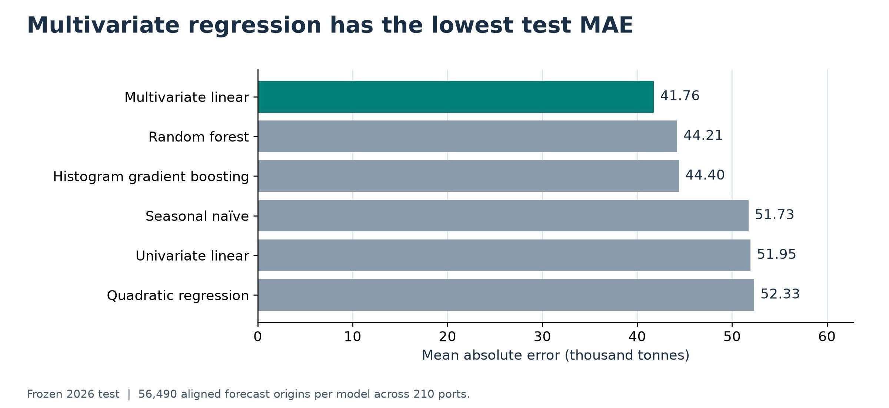
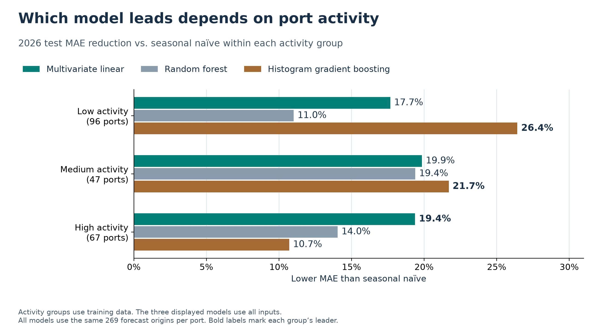
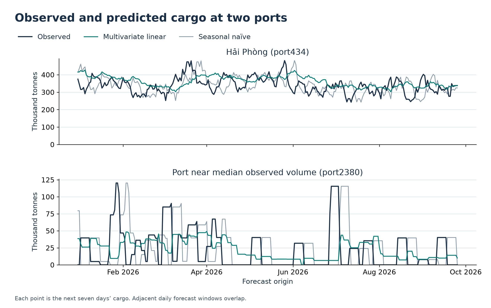
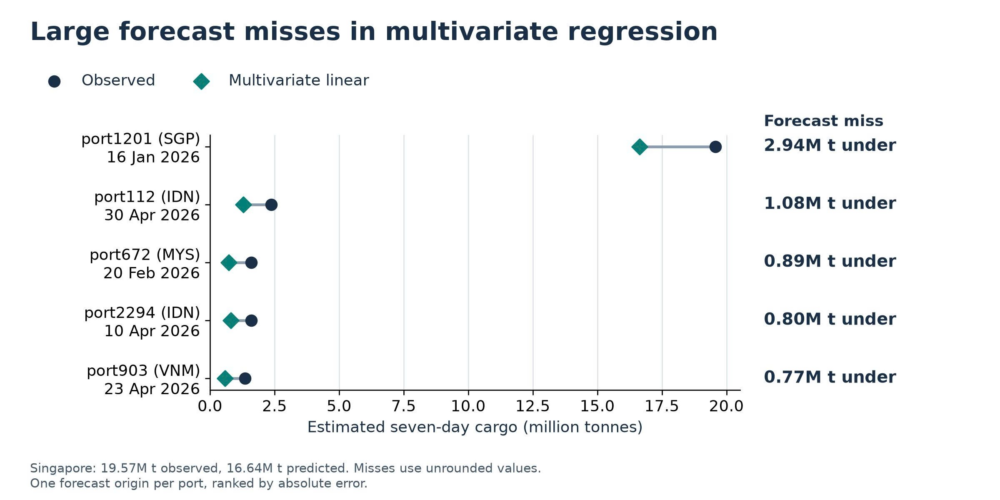

# Results, discussion and operational implications

**Contribution:** Nguyễn Thị Quỳnh Hân, Task 5. This section interprets Định's frozen evaluation at commit `92dd5e427fd703be5be6d58e163933a968bb7fb9` on `task5-validation-evaluation` (PR #8). The core discussion uses the six variants designated as primary before test scoring. The other six tree variants are sensitivity results, not additional opportunities to choose a test winner. All quantities below describe estimated metric tonnes, not TEU, trade value or measured terminal capacity.

## Evaluation population and controls

The evaluation contains 56,490 identical port–origin pairs for each variant: 210 training-eligible port/terminal IDs, each with 269 daily forecast origins from 31 December 2025 to 25 September 2026. Targets are original published cargo totals over the following seven calendar days, with target dates from 1 January to 2 October 2026. Every variant has complete coverage, with no missing, duplicate, invalid or misaligned predictions. The twelve-variant export contains 677,880 predictions. The source coverage report is [task5_test_coverage.csv](../results/task5_test_coverage.csv).

All models were fitted on the same 453,180 training rows from 2019–2024; settings were chosen on 2025 validation and frozen before test scoring. There is no train-plus-validation refit. The frozen nonnegative prediction rule is applied consistently; Định records 10,986 clipped rows across the twelve variants. The 210-port cohort retains observed zeros, and activity bands use only training positive-day shares: low <1/3, medium [1/3,2/3), high >=2/3. These groups were not reassigned using test activity. The [freeze](../results/task5_freeze.json) and [original run record](../results/task5_test_run.json) identify inputs, model code, package versions and checksums.

MAE is the primary error measure, with RMSE, WAPE and signed bias as complementary measures. Positive bias denotes overprediction. WAPE is calculated from sums within the evaluated group, never by averaging percentages across ports. Zero-denominator WAPE is undefined. Pooled and macro-port MAE happen to coincide because every port has 269 observations; this does not normalise error by port scale. Country, activity, per-port and target-stratum results are therefore essential.

## Overall comparison

| Primary model | MAE (tonnes) | RMSE (tonnes) | WAPE (%) | MAE change vs naïve (%) | Mean bias (tonnes) |
|---|---:|---:|---:|---:|---:|
| Seasonal naïve | 51,726.09 | 129,106.54 | 22.54 | 0.00 | +230.22 |
| Univariate linear regression | 51,951.97 | 128,777.22 | 22.64 | +0.44 | +234.13 |
| Degree-2 regression | 52,325.51 | 128,748.33 | 22.80 | +1.16 | +129.30 |
| Multivariate linear regression | **41,760.63** | **109,449.89** | **18.20** | **−19.27** | +1,111.26 |
| Random Forest, all three inputs | 44,210.86 | 130,533.72 | 19.27 | −14.53 | −5,744.21 |
| HGB, all three inputs | 44,403.01 | 140,827.35 | 19.35 | −14.16 | −12,123.43 |

Multivariate regression has the lowest pooled MAE and RMSE among the primary models, reducing MAE by 9,965.46 tonnes per seven-day target (19.27%) relative to seasonal naïve. Both tree models beat naïve on MAE and WAPE, but their RMSE is higher than naïve, particularly for HGB. Thus, their lower typical absolute error coexists with a heavier contribution from large misses. Univariate and degree-2 regression do not beat naïve on the primary MAE criterion, despite slightly lower RMSE. The near-zero pooled bias of naïve is not evidence of low absolute error: over- and underpredictions can cancel.

These are outcomes of the fixed test comparison, not a new model-selection round. The results favour reporting the simple multivariate baseline as the strongest overall performer in this experiment. No model is retrained or routed to a country/port on the basis of these test results.

*Figure 1. Test MAE for the six prespecified primary configurations. Each bar uses the same 56,490 port-origin pairs across 210 ports. MAE is shown in thousands of tonnes per seven-day forecast. The table above gives RMSE and WAPE.*

## Country differences

The country comparison uses all primary models within each country's unchanged port–origin population. The table names the observed minimum-MAE primary model for description only. It does not define a deployable country-specific selection rule.

| Country | Ports | Origins | Naïve MAE | Multivariate MAE | Lowest primary MAE model | Lowest MAE |
|---|---:|---:|---:|---:|---|---:|
| Brunei Darussalam | 2 | 538 | 35,422.59 | 25,893.13 | HGB | 25,393.60 |
| Cambodia | 1 | 269 | 25,817.63 | 23,503.66 | Random Forest | 22,534.07 |
| Indonesia | 101 | 27,169 | 41,424.32 | 33,035.48 | HGB | 32,797.20 |
| Malaysia | 41 | 11,029 | 59,937.29 | 47,161.76 | Multivariate LR | 47,161.76 |
| Myanmar | 2 | 538 | 72,896.22 | 67,115.27 | HGB | 52,551.47 |
| Philippines | 26 | 6,994 | 30,708.89 | 24,485.76 | HGB | 23,278.56 |
| Singapore | 3 | 807 | 388,296.62 | 346,868.06 | Multivariate LR | 346,868.06 |
| Thailand | 13 | 3,497 | 72,945.66 | 57,373.62 | Multivariate LR | 57,373.62 |
| Timor-Leste | 3 | 807 | 1,117.96 | 797.09 | HGB | 701.50 |
| Viet Nam | 18 | 4,842 | 59,098.30 | 48,028.52 | HGB | 47,668.19 |

Multivariate regression improves country MAE relative to naïve in all ten countries. It leads the six-model comparison in Malaysia, Singapore and Thailand; HGB leads in six countries and Random Forest in Cambodia. Country rankings are descriptive and do not establish statistically significant differences. The smallest country samples represent only one or two port/terminal IDs, so they should not be generalised to every port in those economies.

Singapore illustrates why absolute and relative errors must be read together. Multivariate regression's country MAE is 346,868.06 tonnes, yet WAPE is 5.99%; its large shipment scale makes absolute errors substantial. Timor-Leste's MAE is only 797.09 tonnes but WAPE is 141.91%, indicating large error relative to a small denominator. These two observations cannot be ranked sensibly by either measure alone. The full country table provides RMSE, WAPE, bias and sample counts in [country_activity.csv](../results/task5_han/country_activity.csv).

Indonesia and Malaysia contribute 38.05% and 22.05% of multivariate regression's pooled absolute-error sum, reflecting both their port counts and error magnitudes. Singapore has just 3/210 IDs but contributes 11.87%. These percentages describe error over overlapping forecast windows, not shares of distinct annual cargo. The portfolio-wide headline therefore combines geographical coverage and port scale; it should not hide small-country relative errors.

Tree underprediction in Singapore merits attention: mean country bias is −383,565.95 tonnes for Random Forest and −454,005.98 for HGB, compared with +12,280.39 for multivariate regression. This documents underprediction of the published target in this test period. It does not identify whether the cause is a particular vessel event, capacity constraint or structural change. Those explanations need additional evidence.

The [supplementary country chart](../results/task5_han/country_comparison.png) uses signed MAE change relative to seasonal naïve within each country. Negative values show a reduction in MAE. Large positive changes in Timor-Leste reflect its small naïve error scale.

## Training activity and per-port results

| Training activity | Ports | Origins | Naïve MAE | Multivariate MAE | Random Forest MAE | HGB MAE |
|---|---:|---:|---:|---:|---:|---:|
| Low | 96 | 25,824 | 12,683.60 | 10,441.83 | 11,286.15 | **9,331.21** |
| Medium | 47 | 12,643 | 35,422.37 | 28,388.55 | 28,551.68 | **27,734.38** |
| High | 67 | 18,023 | 119,104.50 | **96,015.73** | 102,371.37 | 106,348.06 |

HGB has the lowest MAE in low- and medium-activity groups, while multivariate regression leads high activity. In the low group, multivariate and HGB WAPE are 81.97% and 73.25%; high-group values are 14.60% and 16.17%. Sparse activity has a smaller volume denominator, so smaller tonne errors can still be large in relative terms. HGB's low/medium mean biases are −4,012.74 and −4,450.21 tonnes, and its high-group bias is −29,127.41. Lower MAE does not eliminate the risk of underplanning when forecasts are systematically low.

All 210 per-port results for each primary model are retained in [per_port.csv](../results/task5_han/per_port.csv). Multivariate regression, Random Forest and HGB beat naïve on port MAE for 189, 151 and 192 IDs respectively. Median port MAE is 15,559.68 tonnes for multivariate regression, 15,252.47 for Random Forest and 14,716.42 for HGB, compared with 20,039.82 for naïve. HGB's stronger median-port result is consistent with its strength in less active ports, while multivariate regression's smaller high-volume errors produce the best mean. Neither summary substitutes for the other. Thirteen ports have zero total actual cargo across all evaluated test windows, so their WAPE is undefined for every model; their MAE and RMSE remain reported.

*Figure 2. MAE reduction from seasonal naïve within each training-defined activity group. A bar of 26.4% means that model's test MAE was 26.4% lower than the naïve MAE on the same low-activity port-origin pairs. The displayed models use all three inputs, and each port contributes 269 origins. See the [supplementary activity chart](../results/task5_han/activity_comparison.png) for absolute MAE for all six primary configurations.*

## Zero-actual and positive-actual windows

The fixed test contains 14,626 zero-total windows (25.89%) and 41,864 positive-total windows. Actual-zero classification is retrospective: a planner does not know the future target group at the forecast origin. It is used for diagnosis, never to select which forecast to issue.

| Primary model | Zero-target MAE | Zero-target RMSE | Positive-target MAE | Positive-target RMSE |
|---|---:|---:|---:|---:|
| Seasonal naïve | 5,900.32 | 26,740.55 | 67,736.21 | 149,138.00 |
| Univariate LR | 7,460.44 | 26,953.20 | 67,495.95 | 148,739.89 |
| Degree-2 LR | 9,549.95 | 27,178.12 | 67,269.98 | 148,691.84 |
| Multivariate LR | 5,425.65 | 17,406.14 | **54,454.96** | **126,722.62** |
| Random Forest | 6,983.64 | 16,962.17 | 57,216.92 | 151,299.23 |
| HGB | **2,490.05** | **11,768.05** | 59,046.11 | 163,440.43 |

HGB produces the smallest false positive cargo forecasts on zero-total windows, while multivariate regression is strongest on positive-total windows. With nonnegative predictions, zero-target MAE equals mean forecast volume (and mean signed bias). WAPE on zero-target windows is undefined, not zero, and those errors remain in pooled WAPE's numerator.

On positive-target windows HGB's mean bias is −17,228.93 tonnes, compared with −396.05 for multivariate regression. Thus, reducing false alarms in inactive periods can coexist with underprediction in active periods. This is a diagnostic tradeoff, not a demonstrated causal effect of a particular algorithm. HGB's frozen configuration uses absolute-error training loss, whereas the regression/forest fits use squared-error objectives; this is relevant methodological context, but the experiment does not isolate loss choice as the cause of the observed differences.

Task 1's validation study compared zero-handling policies. Task 5 evaluates models with the already-frozen retain-zero policy; it does not repeat that policy comparison on test. The current results therefore cannot justify changing the zero policy or claim that every published zero is physically correct.

## Observed and predicted cargo

*Figure 3. Observed and predicted seven-day totals for Hải Phòng (port434) and port2380. The latter is the lower of the two middle ports when the 210 ports are ordered by mean observed cargo across their test windows. Each panel shows 269 aligned daily forecast origins and uses its own vertical scale. Neighboring points cover overlapping seven-day windows.*

Hải Phòng illustrates a port with sustained estimated cargo. At port2380 the series includes long troughs and short spikes, some of which multivariate regression underestimates. These two examples illustrate forecast behavior. The table and subgroup results provide the accuracy comparisons for the full test population.

## Large-error cases and overlapping forecasts

*Figure 4. The five ports ranked highest by their maximum absolute multivariate-regression error. For each port, the figure shows its single largest miss. Dates are forecast origins. The 16 January Singapore forecast covers 17–23 January. The difference is calculated using the unrounded estimates.*

Hân's [supplementary forecast histories](../results/task5_han/observed_predicted_cases.png) answer a related question. They select port1201, port112 and port672 by the largest **per-port mean absolute errors** for multivariate regression and plot four primary forecasts at every seventh origin (phase 0). The [case windows](../results/task5_han/case_windows.csv) record the displayed observations and [largest_errors.csv](../results/task5_han/largest_errors.csv) records the largest individual windows by model. Both are retrospective diagnostics. Adjacent large misses may share six cargo days.

At port1201, multivariate-regression MAE is 835,101.94 tonnes (WAPE 5.06%), versus 1,239,684 tonnes for Random Forest and 1,390,975 for HGB. Tree mean biases there are approximately −1.14 million and −1.33 million tonnes per target, compared with +37,680.09 for multivariate regression. This case helps explain the tree models' weaker large-error performance even when they improve typical errors at many other ports. We do not infer a real congestion event from forecast residuals.

For a concrete largest-error window, the 16 January 2026 origin at port1201 targets 17–23 January, with published actual cargo of 19,574,632 tonnes. HGB forecasts 15,380,604.17 tonnes, underpredicting by 4,194,027.83; multivariate regression forecasts 16,639,498.71, underpredicting by 2,935,133.29. Both miss the same high-total window. The 17 January origin shares six of those seven target days, so the two large misses cannot be counted as independent disruptions.

Daily seven-day windows overlap, so their actuals or forecasts must not be summed as independent weekly trade. The evaluator separately scores all seven origin phases, anchored at 31 December 2025. Multivariate regression leads the primary models in every phase, with MAE from 41,574.78 to 42,066.31 tonnes. This demonstrates stability to the weekly offset within this test, not statistical independence or evidence of a causal improvement. Even disjoint weekly targets can retain serial dependence. No independent-row significance test or confidence claim is made here.

## Operational interpretation

The forecast is a planning signal for estimated demand over the coming seven days. It does not determine staffing, equipment or yard occupancy without operational conversion inputs. A useful workflow is to review the forecast alongside vessel schedules, bookings, cargo mix and available resources, then record the decisions made and compare their later outcomes. Country/port group results indicate where more cautious review is warranted; they are not a rule for switching models after observing test outcomes.

| Planning decision | How this forecast can inform it | Extra evidence required before quantifying capacity or benefit |
|---|---|---|
| Staffing and shift preparation | Flag a higher expected seven-day workload for a roster review; retain flexible arrangements where errors or underprediction are large. | Cargo-specific handling productivity, shift length, safety constraints, labour rules, confirmed arrivals and current staffing. |
| Equipment and berth coordination | Review equipment readiness and schedule conflicts when expected cargo rises; compare predicted workload with actual availability. | Equipment type, tonnes or moves per operating hour, maintenance downtime, berth compatibility, vessel ETA and service times. |
| Yard planning | Use the forecast to trigger a review of storage inflow/outflow scenarios and exception monitoring. | Current inventory, cargo mix, dwell time, import/export timing, usable storage area, stacking and safety limits. |
| Sparse-activity ports | Avoid treating every positive forecast as a confirmed vessel/cargo event; check bookings and schedules before committing resources. | Event confirmation, local minimum staffing and costs of unnecessary mobilisation versus missed service. |
| High-volume ports | Review both relative and absolute error, especially large underforecast cases; use local escalation and contingency procedures. | Asymmetric shortage costs, service-level targets, productivity/capacity data and a separately calibrated uncertainty method. |

The present target combines imports and exports. Equal import-plus-export totals can imply different yard loads and handling requirements, so the total cannot directly estimate net inventory. Tonnes cannot be converted to container moves or TEU without cargo-specific information. Higher RMSE and negative bias for the tree models suggest caution about tail underprediction; the dataset does not quantify the monetary cost of those errors. Likewise, HGB's lower zero-window MAE may be relevant to avoiding unnecessary mobilisation, but cost savings have not been measured. Prediction intervals, service-level buffers and quantitative capacity recommendations remain separate analyses requiring appropriate inputs and validation.

## Limitations and conclusion for the paper

This study evaluates a revised historical PortWatch snapshot under the assumption that observations through the forecast origin are available. Origin-specific release times and historical vintages are unavailable, so this is not a verified real-time operational backtest. Published cargo is an estimate; measurement error and revisions may affect both predictors and labels. A zero cargo estimate does not establish physical inactivity. The 210 source IDs include terminals and do not represent every port in each country; Lao PDR is outside the coastal-port forecast panel.

The test covers January–early October 2026, not a full calendar year. Results are conditional on this population, period, frozen feature definitions, model settings and nonnegative rule. Heterogeneous port scale, shared regional events and overlapping horizons limit independence assumptions. Small-country and retrospective case results deserve particular caution. Observed subgroup rankings are hypothesis-generating and must not become test-tuned deployment rules. The optional SARIMA comparison remains Task 4's 67-port **validation** analysis and is not inserted into the 210-port test ranking.

Within these limits, multivariate linear regression provides the strongest overall frozen-test result, while HGB better handles low/medium training activity and zero-total target windows. The contrast supports reporting both overall and subgroup performance and keeping the simple baseline in the model comparison. Forecasts can support workload review and resource coordination; measured congestion, capacity utilisation and proven financial savings cannot be inferred from these forecasts alone.

## Reproduction and review

The authoritative source tables are Định's `results/metrics.csv`, `task5_test_summary.csv`, `task5_test_coverage.csv` and `task5_test_run.json`. Hân's companion tables and figures are generated by `src/report_task5_han.py`; the script does not fit, tune or change a model. It checks the frozen metric hash, aligns saved forecasts against the test reference, and verifies all metric groups before producing the case plots. `results/task5_han/verification.json` records the source and reproduced-file hashes and the numeric comparison tolerance.

The four main figures are Hiếu's supplied graphics. The [figure handoff](../results/README.md#task-5-figure-set) records their selection, authorship and the command to recreate their data views. Hân's [handoff guide](task5_han_handoff.md) documents her supporting analysis and outputs. The Task 5 owners can review the combined results and captions together.
